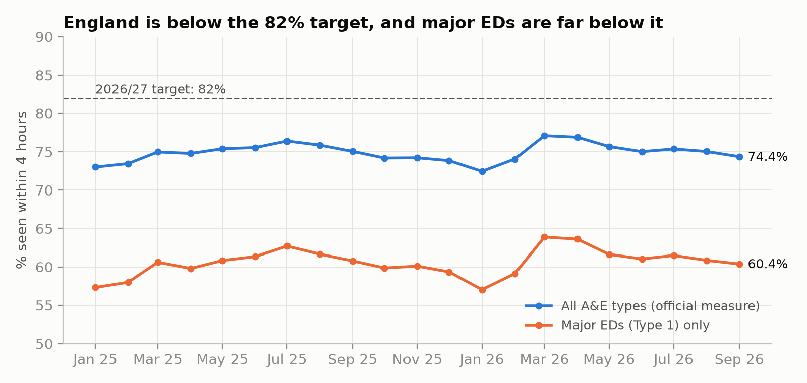
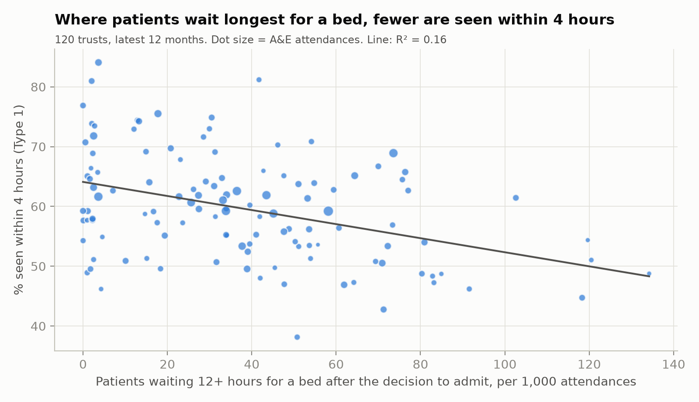
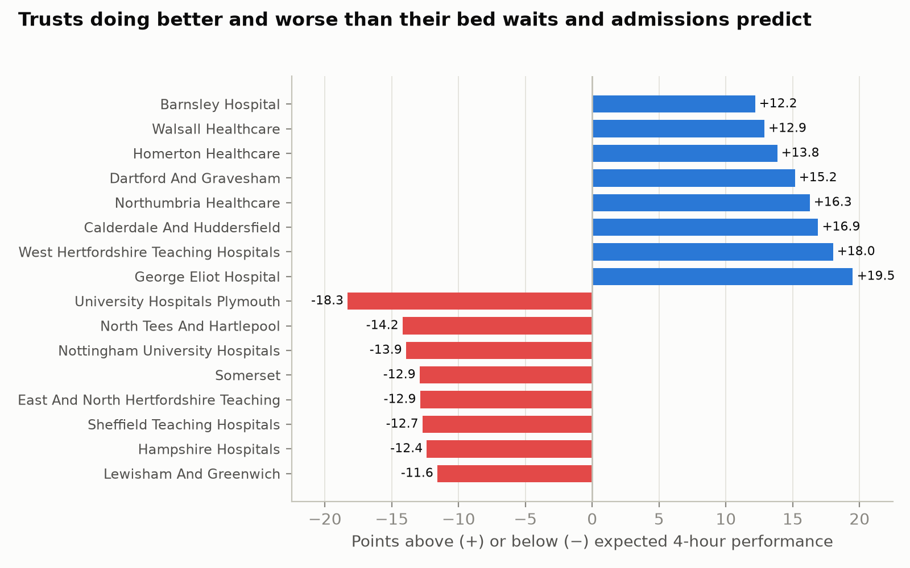

# A&E waits in England: front door or back door?

NHS England's target for 2026/27 is for 82% of A&E patients to be admitted, transferred or discharged within 4 hours. This project uses NHS England's published monthly A&E statistics to ask a policy question:

**Are trusts missing the 4-hour standard because too many people arrive (the front door), or because patients who need a bed cannot get one (the back door)? And which trusts do better than their pressures would predict, so others can learn from them?**

## Findings (data to September 2026)

* **England is 7.6 points short of the target.** In September 2026, 74.4% of patients were seen within 4 hours across all A&E types and 60.4% at major emergency departments (Type 1). Reaching 82% would mean about 187,000 more patients a month seen within 4 hours.
* **Almost no major ED meets 82%.** Over the last 12 months, 1 of 120 trusts with a major ED reached 82% at Type 1 (range 38% to 84%).
* **Long waits for a bed are the strongest single signal.** Trusts with more patients waiting 12+ hours for a bed after the decision to admit have lower 4-hour performance. On its own this explains about 16% of the difference between trusts; adding the share of patients admitted and trust size takes it to 25%.
* **Busier months are not the problem.** Comparing each trust with itself, a month with 10% more attendances than usual had slightly *better* 4-hour performance (+1.3 points), while a month with more 12-hour bed waits had worse performance (−0.7 points per standard deviation). Demand at the front door does not explain month-to-month performance; flow out of A&E does.
* **Most of the variation is local.** Three-quarters of the difference between trusts is not explained by bed waits, admissions or size. Some trusts do much better than their pressures predict (for example George Eliot, West Hertfordshire, Calderdale and Huddersfield, Northumbria) and some much worse (for example Plymouth, North Tees and Hartlepool, Nottingham). Those gaps are where learning between trusts is most likely to pay off.





## Method

| Step | What it does |
|---|---|
| Load (`src/load.py`) | Reads the 21 monthly CSVs, removes the national TOTAL row and rebuilds England figures from the providers. Fails loudly on missing columns or a month loaded twice. |
| Check (`tests/`) | Rebuilt England totals must equal NHS England's published TOTAL row in every month; one row per provider per month; consecutive months. |
| Trusts | Providers averaging at least 3,000 Type 1 attendances a month. Children's hospitals are excluded because their case mix is not comparable. |
| Between-trust model | Ordinary least squares on 12-month totals: Type 1 4-hour % against 12-hour bed waits per 1,000 attendances, % of patients admitted and log attendances. Robust (HC3) standard errors; 5-fold cross-validated R². |
| Within-trust model | Trust-month panel with trust and month fixed effects, standard errors clustered by trust. Compares each trust with itself, so fixed differences (size, buildings, case mix) and national shocks (winter) drop out. |
| Better or worse than expected | Actual 4-hour % minus the between-trust model's prediction. |

### A data issue found on the way

In the February 2026 file the national total row is labelled `TOTAL` in the *Org Code* column instead of the *Period* column used in every other month. A naive load counts England twice for that month (4.2 million attendances instead of 2.1 million). The loader checks both columns, and a test reconciles every month against the published total.

## Limitations

* **Association, not cause.** Long waits for a bed are both a cause and a symptom of a crowded A&E, so the models show how closely the measures move together, not how much one causes the other.
* **Missing explanations.** The data has no measure of bed occupancy, delayed discharges, staffing, deprivation or patient age, which are likely to explain much of the unexplained variation.
* **Type 1 only for trusts.** Trust comparisons use major emergency departments only, because attribution of minor-injury units and urgent treatment centres varies between trusts.
* **Short window and revisions.** 21 months of data; NHS England revises some months after publication.

## Next steps

Add bed occupancy and discharge-delay data at trust level to test the "back door" explanation more directly, and look at what the trusts doing better than expected have in common.

## Run it

```bash
pip install -r requirements.txt
python -m pytest -q tests      # data checks
python src/analysis.py         # writes outputs/ and outputs/figures/
```

## Data

NHS England, *A&E Attendances and Emergency Admissions*, monthly provider-level CSVs, January 2025 to September 2026, downloaded from
https://www.england.nhs.uk/statistics/statistical-work-areas/ae-waiting-times-and-activity/
Contains public sector information licensed under the Open Government Licence v3.0.
